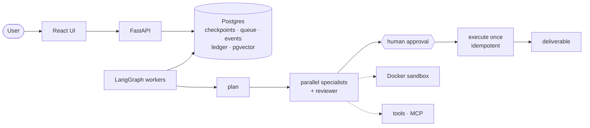

# AgentOps

Durable multi-agent orchestration with a human in the loop. A supervisor plans, specialist
agents (research, analysis, code, writing) work in parallel waves, a reviewer checks every
result, and nothing leaves the system (an email, a note) until a human approves it. Runs
survive worker crashes, never repeat a side effect, stay inside a hard cost budget, and can be
replayed from any checkpoint.

Built on LangGraph with Postgres doing the heavy lifting: checkpoints, a job queue, an event
log streamed to the UI over SSE, a budget ledger, and pgvector memory. React UI, Docker
sandbox for generated code, MCP tools, and an eval harness that measures the whole system
with real models.

**Status:** Completed locally. Phase 6 (hardening, evals, docs) is being finished; see
[`docs/PROGRESS.md`](docs/PROGRESS.md).



## Measured results

From the eval harness (`evals/`): 60 scenarios × 3 runs with real models (Claude Sonnet 5.5 and
Haiku 5.5 as agents, Claude Opus 5.5 as an independent judge). This table is generated from the
committed results; methodology, per-category numbers, the fixes the eval led to and the
re-measure are in [`docs/EVALUATION.md`](docs/EVALUATION.md).

<!-- eval-table:headline -->
Baseline: first paid run `2026-11-10-163339-real` + `2026-11-10-172318-real` (the 3 runs its cost reservation skipped). Judge `claude-opus-5-5`. Wilson 95% intervals.

| Metric | Baseline |
|---|---|
| Pass rate, all 60 scenarios (k=3) | 61.1% (110/180; 95% CI 53.8%–67.9%) |
| Unsafe actions (must be 0) | **0** |
| Reviewer precision / recall (planted defects) | 100.0% / 100.0% (tp 18, fp 0, fn 0, tn 12) |
| Escalation rate (agentic runs) | 40.9% (54/132; 95% CI 32.9%–49.4%) |
| Loop rate (cap hit or no clean finish) | 0.0% (0/198; 95% CI 0.0%–1.9%) |
| Memory lift (pass rate, memory on − off) | +11.1 pts (n=18 pairs; bootstrap 95% CI +0.0 to +27.8) |
| Cost per agentic run, p50 / p95 | $0.0473 / $0.1200 |
| Latency per agentic run, p50 / p95 | 35.9 s / 100.3 s |
| Eval spend (agents + judge) | $13.3857 |
<!-- /eval-table:headline -->

The baseline exposed a planner that couldn't see which specialist owns the database, which
failed every SQL scenario. Its fix (ADR-047) clearly improved the SQL and email scenarios it
targets (before/after table in `docs/EVALUATION.md`). That re-measure is partial, cut short by
the API workspace's monthly spend limit. Read its caveats before quoting it.

## Gallery

| | |
|---|---|
|  |  |
| Task detail: live plan DAG, reviews, approved email, deliverable | Approvals inbox: edit form generated from the tool's schema |
|  |  |
| Trace & cost: compute vs human wait, per-agent cost, timeline | Replay: fork at a checkpoint, compare branches |

Every page in light and dark, desktop and mobile: [`docs/screenshots/`](docs/screenshots/).
Screenshots show real API data from a fake-mode run.

## Quick start

Linux, or Windows with WSL2 (Docker Engine inside WSL; tested). macOS with Docker Desktop or
Colima should work but is untested; see [`docs/DEPLOYMENT.md`](docs/DEPLOYMENT.md).

```bash
cp .env.example .env
uv sync
make build-sandbox   # image for generated code (never a service)
make up              # postgres, mailpit, docker-socket-proxy, mcp-notes, api, worker, ui
make migrate         # schema + checkpointer + seed users (tokens -> .agentops-tokens)
```
Open http://localhost:5173, sign in with `demo-user` from `.agentops-tokens`, and run the
`ui_demo` scenario. [`docs/DEMO.md`](docs/DEMO.md) is a 5-minute walkthrough. Fake mode
(scripted models, $0) is the default; real models need `LLM_MODE=real` and an Anthropic key.

```bash
make test        # backend: unit + integration + sandbox, fake models, no API keys
make test-ui     # UI: ESLint + tsc + Vitest
make e2e         # Playwright walkthrough + axe against the running stack
make eval        # free: replay recorded model cassettes + dry run of all 60 scenarios
```

## How it holds up

- **Never acts without approval, never twice.** Specialists can only *propose* external
  actions. One serial node executes approved ones, behind an idempotency key that is also
  the email's `Message-ID`. SIGKILL tests cover every step of the send path.
- **Crash-safe.** Workers hold leases. A killed worker's task resumes from its last checkpoint
  on another worker.
- **Bounded.** Every loop has a counter cap, and every run ends in exactly one terminal state.
  Every model call reserves its worst-case cost first, so a task can't overspend its budget.
- **Injection-aware.** Tool output is framed as untrusted data, outbound actions need a human,
  `fetch_url` can't exfiltrate through invented URLs, and memories can't become standing orders.
  [`docs/SECURITY.md`](docs/SECURITY.md) has the threat model.

## Limitations

- The eval re-measure after fixes is partial (API spend limit). Memory scenarios score lowest
  of all categories, and their fix (ADR-048) is not yet re-measured.
- Fixture web pages and a synthetic demo database, not the live web.
- Auth is seeded bearer tokens with two roles (no OAuth/SSO, no token expiry).
- The compose files have no TLS or backups; production needs a reverse proxy and `pg_dump`.
- Tested on Docker Engine in WSL2 only.

## Docs

[Architecture](docs/ARCHITECTURE.md) · [Evaluation](docs/EVALUATION.md) ·
[Security](docs/SECURITY.md) · [Deployment](docs/DEPLOYMENT.md) · [Demo](docs/DEMO.md) ·
[Decisions (ADR-001…050)](docs/DECISIONS.md) · [Progress](docs/PROGRESS.md) ·
[Requirements](docs/BRIEF.md)
