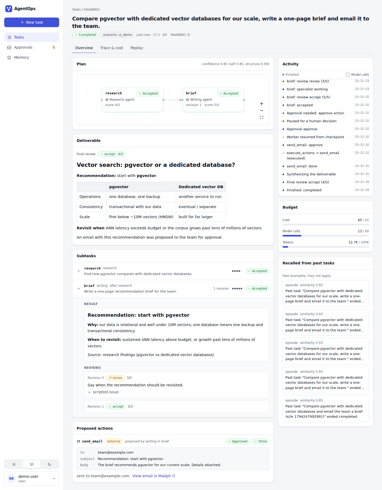
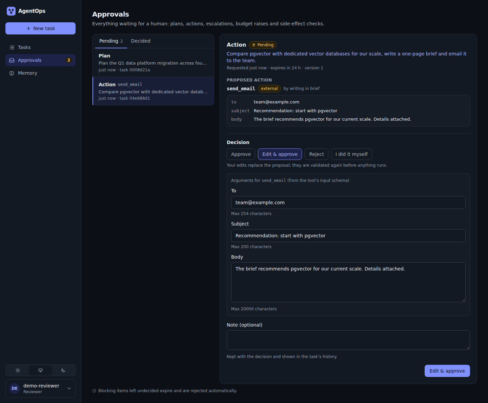
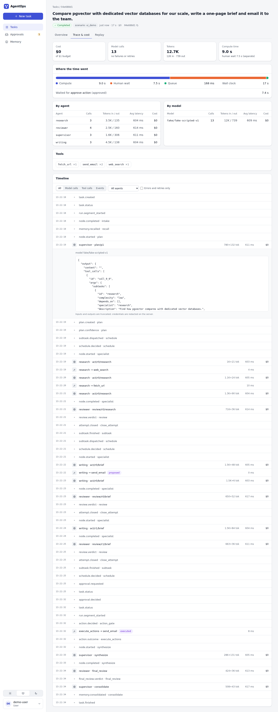
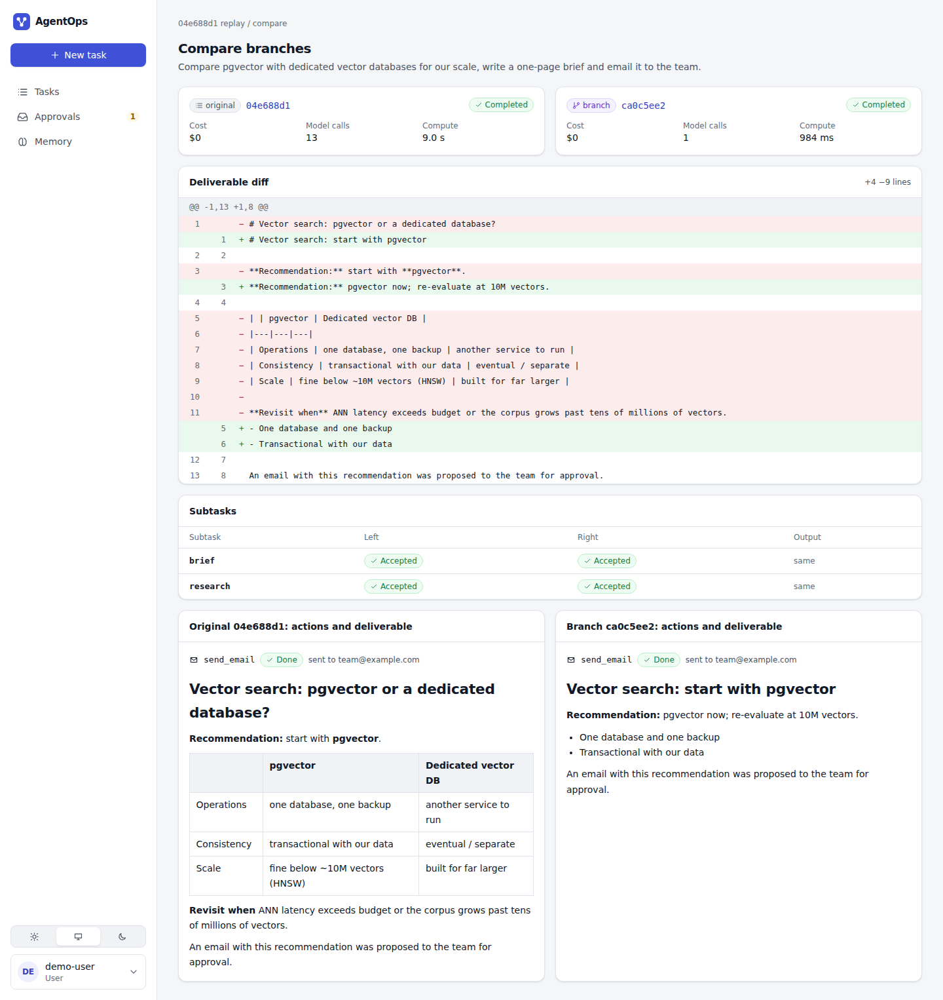

# AgentOps

Multi-agent orchestration platform: a supervisor plans, specialist agents (research, analysis, writing, code) do the work, a reviewer checks it, and a human approves anything risky. Built on LangGraph with a Postgres checkpointer, a Postgres job queue, pgvector memory, and an event log that drives live progress over SSE.

**Status:** Phase 5 of 6 (awaiting review). Durable runs with plan/action/escalation gates, idempotent side effects, long-term memory, a web UI with live plan DAGs, an approvals inbox, trace and cost views, and replay with branch comparison. See [`docs/PROGRESS.md`](docs/PROGRESS.md).

| | |
|---|---|
|  |  |
| Task detail: live plan DAG, reviews, approved email, deliverable | Approvals inbox: edit form generated from the tool's schema |
|  |  |
| Trace & cost: compute vs human wait, per-agent cost, timeline | Replay: fork at a checkpoint, compare branches |

More in [`docs/screenshots/`](docs/screenshots/) (every page, light and dark, desktop and mobile). All of it is real API data from a fake-mode run.

## Quick start (WSL2 / Linux, Docker)
```bash
cp .env.example .env
uv sync
make up          # postgres, mailpit, docker-socket-proxy, mcp-notes, api, worker, ui
make migrate     # alembic upgrade head + LangGraph checkpointer setup + seed users
make test        # backend: unit + integration + sandbox (fake model, no API keys)
make test-ui     # UI: lint + typecheck + Vitest
make e2e         # Playwright walkthrough against the running stack
```
Open http://localhost:5173 and sign in with a token from `.agentops-tokens` (`demo-user`, `demo-reviewer`). In the new-task form pick the `ui_demo` scenario for the full walkthrough; `FAKE_LATENCY_MS=600 make up` makes fake runs unfold visibly.

Run a task (fake mode, scripted models, $0):
```bash
TOKEN=$(awk -F= '/^demo-user=/{print $2}' .agentops-tokens)
curl -s -X POST localhost:8000/tasks -H "Authorization: Bearer $TOKEN" \
  -H 'Content-Type: application/json' -d '{"request":"Explain pgvector.","scenario":"revise_once"}'
curl -N localhost:8000/tasks/<id>/events -H "Authorization: Bearer $TOKEN"   # live progress (browsers use a single-use stream ticket)
```
Scenarios include `ui_demo`, `default`, `revise_once`, `revisions_exhausted`, `proposes_email`, `low_confidence_plan`, `partial_ok` (full list: `GET /tasks/scenarios`, `agentops/models/scenarios.py`). Real models: set `LLM_MODE=real` and the role models in `.env` (see `.env.example`).

Docs: [`docs/BRIEF.md`](docs/BRIEF.md) (requirements) · [`docs/DECISIONS.md`](docs/DECISIONS.md) (architecture decisions) · [`docs/PROGRESS.md`](docs/PROGRESS.md) (status).
