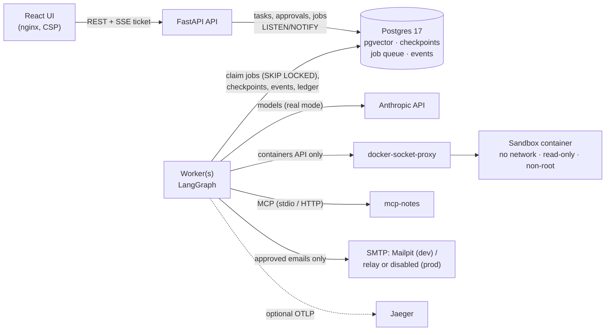
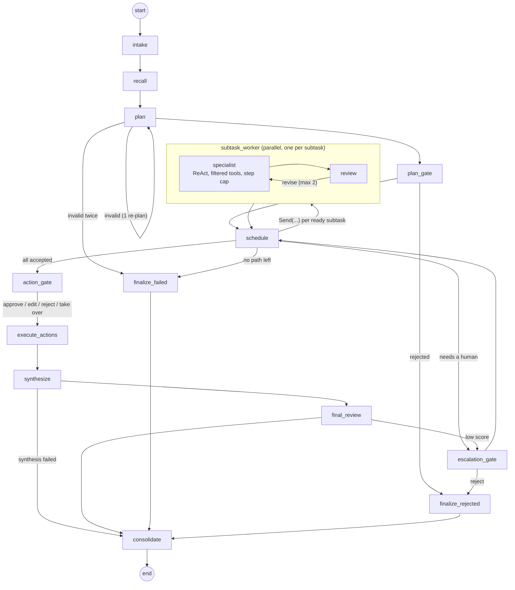

# Architecture

AgentOps runs multi-agent tasks durably: a supervisor plans, specialists work in parallel
waves, a reviewer checks every result, and a human approves anything that leaves the system.
This page is the map; `docs/DECISIONS.md` holds the reasons (ADR-001 … ADR-050) and wins
where the two disagree.

## Services

- **API** (`agentops/api`): bearer-token auth (HMAC-peppered hashes), owner-scoped queries,
  per-user rate limits, keyset pagination, single-use SSE tickets. It never runs a graph.
- **Worker** (`agentops/queue/worker.py`): claims a job, runs one *segment* of a task's graph
  under a lease with heartbeats, and stops at an interrupt or a terminal state. A killed worker's
  lease expires and another worker resumes from the last checkpoint.
- **Postgres** is the only stateful service: LangGraph checkpoints, the job queue, the event
  log (the UI's source of truth, pushed over SSE via `LISTEN/NOTIFY`), the budget ledger, the
  `side_effects` table, approvals, and pgvector memories.

## The graph

**Invariants**, each covered by tests:
- Parallel branches never call `interrupt()` and never cause side effects. Every interrupt is in
  a serial node (`plan_gate`, `escalation_gate`, `action_gate`).
- Every side effect runs in `execute_actions`, behind an idempotency key in `side_effects`
  (also passed to the receiver, e.g. the email `Message-ID`). A crash can under-execute, never
  double-execute; an ambiguous outcome goes to a human, never a retry.
- Every cycle (revise loop, re-plan, schedule waves, escalations) has a counter cap that does not
  depend on the model.
- Every run ends in exactly one terminal state: `completed`, `completed_partial`, `failed`,
  `rejected`, `cancelled`, `budget_exceeded`.

## Agents and tools

| Specialist | Model (real mode) | Tools |
|---|---|---|
| research | Haiku 5.5 | `web_search`, `fetch_url` (only URLs the task has already seen), notes search (MCP), workspace |
| analysis | Sonnet 5.5 | `describe_schema`, `sql_query` (read-only role, one SELECT), `run_python` (sandbox), workspace |
| code | Sonnet 5.5 | `run_python` (sandbox), workspace |
| writing | Haiku 5.5 | `send_email` and notes `create_note` / `delete_note` (**proposals only**), notes search, workspace |
| supervisor / reviewer | Sonnet 5.5 | none (planning, synthesis / structured verdicts) |

All tool calls go through one registry (`agentops/tools/registry.py`): allowed-agent check,
Pydantic validation, the risk policy (read executes; external/destructive/outside writes become
**proposals**), a per-user token bucket, a timeout, and a `tool_calls` row for every outcome.
Tool results reach models only inside `<tool_result trust="untrusted">` frames.

## Budgets and cost

Every model call first **reserves its worst case** (exact input tokens via `count_tokens` +
the output cap, priced from a dated price table) in a per-task ledger, then settles the actual
cost. A call that could cross the task's budget is refused before it is made, so spend never
exceeds the cap (ADR-024).

## Memory

`recall` searches the user's own memories (pgvector, similarity floor, ranked by similarity,
importance and recency) and gives them to the planner and the synthesizer as labelled data.
`consolidate` writes one episode per task plus up to 3 lessons from reviewer-accepted output,
after screening out copied tool text and anything that reads like an instruction (ADR-038, 045).

## Replay

Any serial checkpoint can be forked into a branch (a new task with its own thread), optionally
with edited state; branches never perform side effects or write memories, and the UI compares
branches side by side (ADR-040).

## Code map

| Path | What |
|---|---|
| `agentops/core/` | graph, state, nodes, prompts, scheduler, budget ledger |
| `agentops/queue/` | Postgres job queue and worker |
| `agentops/tools/` | registry, native tools, MCP client, sandbox |
| `agentops/models/` | model client (reserve → call → record → settle), pricing, fake scripted models |
| `agentops/memory/` | embeddings, recall, consolidation screen |
| `agentops/api/` | FastAPI routes, read models, auth, rate limits |
| `ui/` | React + TypeScript UI |
| `evals/` | eval harness, scenarios, results |
| `mcp_servers/notes/` | the MCP notes server |
| `sandbox/` | sandbox image |
